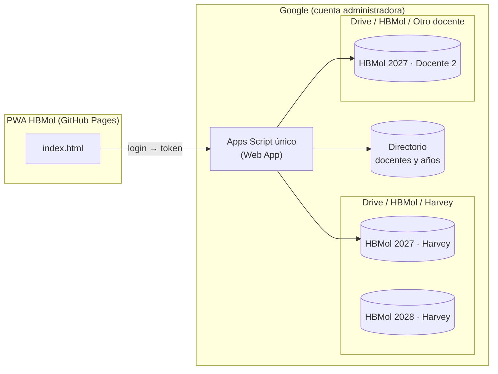
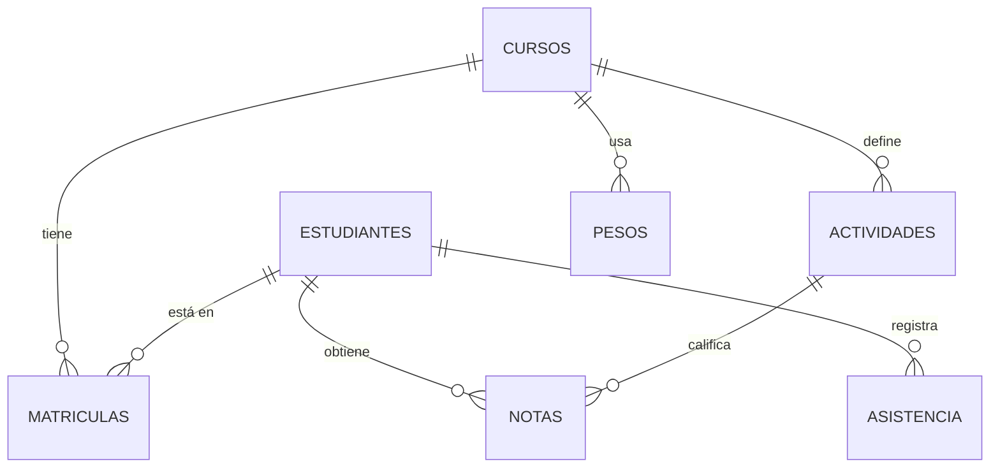
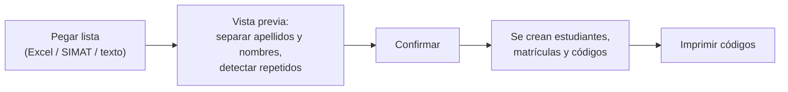

# HBMol 2027 — Plan de diseño

Documento para estructurar en diciembre de 2026 la versión nueva de HBMol y tenerla lista para el inicio de clases de 2027. **No se ha construido nada todavía**: aquí están las decisiones tomadas, las opciones abiertas y el plan por etapas.

> Recordatorio programado: **15 de diciembre de 2026** para empezar este trabajo.

---

## 1. Decisiones ya tomadas

| Tema | Decisión |
|---|---|
| Dónde se construye | **Repositorio nuevo y aparte** (por ejemplo `hbmol`), copiado desde el `main` actual de GestiónQM. GestiónQM sigue funcionando igual. |
| Datos | **Se empieza desde cero en 2027.** No se migra asistencia ni notas de 2026. GestiónQM queda como consulta de 2026. |
| Listas de estudiantes | Se **cargan al inicio de cada año**. No hay promoción automática de grado. |
| Cambios de curso | Pueden ocurrir en cualquier momento del año (ya pasó en 2026). Se registran como **traslado con fecha**, sin perder la historia. |
| Código del estudiante | Lo **genera la app automáticamente** al cargar la lista. |
| Otros docentes | El diseño debe permitir que **otros docentes se unan**, cada uno con **sus propias hojas**. |
| Backend | **Un solo proyecto de Apps Script** para Asistencia y Notas (hoy son dos). |

---

## 2. Qué problemas de hoy resuelve

1. **Dos listas de estudiantes.** Asistencia y Notas tienen cada una su propio registro, y los informes los cruzan por nombre. Falla si un nombre se escribe distinto o si hay dos estudiantes con el mismo nombre (el informe omite la asistencia).
2. **Dos Apps Script, dos URL y dos contraseñas** que hay que mantener iguales a mano.
3. **Cursos:** al crear un curso hay que cargar los estudiantes dos veces.
4. **Año nuevo:** no hay forma de empezar un año limpio; todo se acumula en las mismas hojas.
5. **Códigos predecibles:** hoy el código es del tipo `100401` (curso + número). El portal de consulta (`queryStudent`) no pide contraseña, así que cualquiera puede probar códigos seguidos y ver las notas de otro estudiante.
6. **Un solo docente:** la contraseña, el nombre "Harvey" y el colegio están escritos en el código.

---

## 3. Arquitectura general



- **Una sola URL de servidor.** El `doGet` y el `doPost` reparten las peticiones por módulo (`att.*`, `grd.*`, `inf.*`, `adm.*`).
- **Una hoja Directorio** (central) con los docentes y la hoja de cada docente por año.
- **Una hoja de cálculo por docente y por año.** Así se aísla la información de cada docente, cada año queda cerrado y las hojas no crecen sin límite.
- **El año activo de cada docente** se busca en el Directorio; la app no tiene IDs de hojas escritos en el código.

### 3.1 Opciones para varios docentes

| | A. Servidor central (recomendada) | B. Copia por docente | C. Inicio de sesión con Google |
|---|---|---|---|
| Cómo funciona | Un solo Apps Script, ejecutado como la cuenta administradora, crea y abre la hoja de cada docente. | Cada docente copia una plantilla (hoja + script) y publica su propio Apps Script. | El script se ejecuta como el usuario que entra, y cada docente usa su propio Drive. |
| Actualizaciones | Una sola vez, para todos. | Cada docente debe pegar el código nuevo. | Una sola vez. |
| Dónde viven los datos | Drive de la cuenta administradora (compartidas con cada docente). | Drive de cada docente. | Drive de cada docente. |
| Dificultad para el docente | Ninguna: recibe usuario y contraseña. | Alta: debe implementar Apps Script. | Media: inicia sesión con Google. |
| Problemas | Cuotas de Apps Script compartidas (unas 30 ejecuciones simultáneas). Sobra para un grupo pequeño de docentes. | Versiones distintas en cada docente; soporte difícil. | La PWA en GitHub Pages no puede llamar fácilmente a un script "como el usuario" (sesión de Google y CORS). Requiere más trabajo y pruebas. |

**Recomendación:** empezar con la opción **A**. Lo ideal es que la cuenta administradora sea una **cuenta institucional o creada solo para HBMol**, no la personal, para que los datos no dependan de una sola persona. Si algún día se unen muchos docentes o el colegio quiere que cada uno sea dueño de sus datos, se puede pasar a la opción C.

### 3.2 Datos personales de menores

Las hojas guardan nombres, notas y asistencia de menores de edad. En Colombia esto entra en la Ley 1581 de 2012 (protección de datos personales). Mínimos de diseño:

- Cada docente ve **solo sus cursos**.
- Las hojas se comparten **solo** con el docente dueño, nunca "con cualquiera que tenga el enlace".
- El portal del estudiante muestra solo lo del propio estudiante y usa códigos difíciles de adivinar (ver §5).
- Hay un registro (Log) de quién cambió qué.
- Antes de invitar a otros docentes, conviene consultarlo con coordinación o rectoría.

---

## 4. Modelo de datos

### 4.1 Directorio (una sola hoja central)

**Docentes**

| Columna | Ejemplo | Nota |
|---|---|---|
| docenteId | `d_7k2m` | Generado. |
| nombre | Harvey Barcenas Morales | Aparece en informes y saludo. |
| correo | … | Para compartirle sus hojas. |
| asignaturas | Química | Lista separada por comas. |
| rol | `admin` / `docente` | El admin invita docentes. |
| claveHash, sal | — | La contraseña **nunca** se guarda en texto plano. |
| activo | TRUE | Desactivar sin borrar. |

**Años**

| docenteId | año | spreadsheetId | estado | creado |
|---|---|---|---|---|
| d_7k2m | 2027 | 1AbC… | `activo` | 2027-01-15 |
| d_7k2m | 2028 | 1XyZ… | `activo` | 2028-01-14 |

Al iniciar 2028, el año 2027 pasa a `cerrado`: se puede consultar, pero no editar.

### 4.2 Hoja del docente para un año



| Pestaña | Columnas principales | Para qué |
|---|---|---|
| **Config** | institución, año, docente, periodos (P1–P3 o P1–P4) con fechas, pesos por defecto, colores | Lo que hoy está escrito en el código. |
| **Cursos** | cursoId, código (1004), grado, grupo, asignatura, color, activo | Cursos del año. |
| **Estudiantes** | estudianteId, código, apellidos, nombres, documento (opcional), estado (`activo`/`retirado`), fecha ingreso | **Una sola lista** para Asistencia y Notas. |
| **Matriculas** | estudianteId, cursoId, desde, hasta, motivo | Historia de cursos; permite traslados con fecha (§6). |
| **Asistencia** | fecha, cursoId, estudianteId, estado (P/A/T/J/E), guardadoEn | Clave por **ID**, no por nombre. |
| **Actividades** | actividadId, cursoId, periodo, nombre, fecha, tipo | Las columnas "Act.1, Act.2…" de hoy. |
| **Notas** | cursoId, periodo, componente, actividadId, estudianteId, nota (o `NE`) | Igual que hoy, pero con IDs. |
| **Especiales / Pesos** | Igual que hoy | Se conserva la lógica actual de pesos. |
| **Log** | fecha, docente, acción, curso, detalle | Auditoría. |
| *Vistas* `1004-P1`… | Generadas | Solo lectura, para revisar en Sheets. |

**Regla clave:** cada fila de asistencia y de notas guarda el **cursoId en que se tomó**. Si un estudiante se traslada, su historia anterior no se mueve sola.

---

## 5. Código automático del estudiante

El código sirve para dos cosas: identificar al estudiante en listas y exportes, y entrar al **portal de consulta** sin contraseña. Por la segunda razón no debe poder adivinarse.

| Opción | Ejemplo | A favor | En contra |
|---|---|---|---|
| A. Legible con el curso | `27-1004-07` | Fácil de leer. | Se puede adivinar; queda "viejo" tras un traslado. |
| B. Consecutivo del año | `27-0153` | Estable con traslados. | Se puede adivinar. |
| **C. Aleatorio con verificador (recomendada)** | `Q7K-4M2` | No se adivina; estable con traslados; detecta errores de digitación. | Hay que entregarlo impreso a cada estudiante. |

**Recomendación C:**
- 6 caracteres de un alfabeto sin letras confusas (sin `0/O`, `1/I/L`), más un dígito verificador. Se muestra como `Q7K-4M2`.
- Se genera en el servidor con `LockService` para que nunca se repita, ni siquiera entre docentes.
- **No cambia** si el estudiante se traslada de curso.
- Al cargar la lista, la app ofrece **"Imprimir stickers"** para pegar en el cuaderno (ver §5.1).
- El portal limita los intentos (por ejemplo 10 por minuto) para frenar a quien pruebe códigos al azar.

Si prefieres seguir usando el código del colegio (SIMAT u otro), se agrega una columna `codigoInstitucional` aparte, sin usarla para entrar al portal.

### 5.1 Sticker para el cuaderno

Cada estudiante recibe un sticker para pegar en la portada o primera hoja del cuaderno. Se genera por curso desde **Estudiantes → Imprimir stickers**.

```
┌──────────────────────────────────────────────┐
│ [logo] HBMol · Química 2027        Curso 1004 │
│                                              │
│  ROJAS GÓMEZ, Ana María                      │
│  Código:  Q7K-4M2                            │
│                                              │
│  [QR]  IONOM            [QR]  HarveyLab      │
│        (herramienta 10°)      guías y        │
│                               actividades    │
└──────────────────────────────────────────────┘
```

| Elemento | Contenido |
|---|---|
| Encabezado | Logo HBMol, asignatura, año y curso. |
| Nombre completo | Apellidos y nombres, tal como quedaron en la lista. |
| Código | En letra grande y monoespaciada, para dictarlo sin errores. |
| Enlace por grado | **Grado 10° → IONOM** (`hbarcenasm863.github.io/ionom`), **grado 11° → CHROMANOM** (`hbarcenasm863.github.io/chromanom`). El grado sale de la columna `grado` de Cursos, no del número del curso, para que funcione si cambia la numeración. |
| Enlace fijo | **HarveyLab**: `sites.google.com/view/harveylab` (repositorio de guías y actividades). |

- Cada enlace va como **código QR** más la dirección corta escrita debajo, para quien no pueda escanear.
- Los enlaces por grado se guardan en **Config** (`enlace_10`, `enlace_11`, `enlace_sitio`), no en el código. Así otro docente pone los suyos o deja solo el del sitio.
- Formatos de impresión, a elegir al imprimir:
  - **Hoja carta para recortar**: 10 stickers por hoja (2 × 5, de unos 10 × 5 cm), con líneas de corte.
  - **Papel adhesivo de etiquetas**: plantilla tipo carta 2 × 5 (como las etiquetas de envío de 10 × 5 cm que venden en papelerías).
- Se puede imprimir **un solo sticker** desde la ficha del estudiante, por ejemplo para quien llega a mitad de año, si se traslada de curso o si pierde el cuaderno. El código no cambia, así que el sticker viejo sigue sirviendo, salvo por el curso impreso.
- Los QR se generan en la propia app, sin enviar nombres a servicios externos (librería de QR cargada desde cdnjs).

---

## 6. Carga de listas y cambios de curso

### 6.1 Carga al inicio del año



- Se acepta "APELLIDOS, Nombres", "Nombres Apellidos" o columnas pegadas desde Excel.
- La vista previa avisa si hay nombres repetidos dentro del curso o si un estudiante ya está en otro curso del mismo docente.
- Alumnos que llegan a mitad de año: "+ Agregar estudiante" con su **fecha de ingreso**. La asistencia anterior a esa fecha no cuenta como falla.

### 6.2 Traslado entre cursos (como pasó en 2026)

Acción **"Trasladar"** en la ficha del estudiante: curso destino, fecha y motivo.

- Se cierra la matrícula en el curso anterior (`hasta = fecha`) y se abre en el nuevo (`desde = fecha`).
- **Asistencia:** lo anterior queda en el curso viejo; el informe del estudiante suma ambos cursos dentro de las fechas del periodo.
- **Notas:** la app pregunta qué hacer con las notas del periodo en curso:
  1. **Llevarlas** al curso nuevo (las actividades con el mismo nombre se emparejan; las demás quedan como "especial: notas del curso anterior").
  2. **Dejarlas** en el curso anterior y mostrarlas como referencia en el informe.
- Las listas, el consolidado y las vistas usan la matrícula vigente **en cada fecha**. Así el estudiante no aparece como "sin marcar" en el curso viejo después de irse.
- Retiro del colegio: igual que un traslado, pero sin curso destino (estado `retirado`).

---

## 7. Inicio de un año nuevo

Asistente **"Iniciar año 2028"** (solo cuando el año actual terminó o desde diciembre):

1. Crea en Drive `HBMol / <Docente> / HBMol 2028` a partir de la plantilla, con todas las pestañas.
2. Pregunta qué copiar del año anterior: **cursos** (sí/no), **pesos y colores** (sí/no) y las **fechas de los periodos** (se proponen las del año anterior con +1 año, para editar).
3. **No copia estudiantes**, porque las listas se cargan al inicio de cada año.
4. Registra el año nuevo en el Directorio como `activo` y deja el anterior como `cerrado` (solo lectura).
5. La app muestra un selector de año (2027 ▾) para consultar años cerrados.

El cierre también genera un **respaldo final** del año en CSV dentro de la misma carpeta.

---

## 8. Seguridad y acceso

- **Inicio de sesión por docente:** correo + contraseña. El servidor compara un hash (SHA-256 con sal, usando `Utilities.computeDigest`).
- **Token de sesión:** al entrar, el servidor entrega un token firmado que vence a las 12 h. Las peticiones envían el token, no la contraseña (hoy la contraseña viaja en cada petición, incluso en la URL).
- Se conserva el **bloqueo automático** de la app actual (2 min en segundo plano / 15 min sin uso).
- **Invitar docente** (rol admin): crea su fila en Docentes y una contraseña temporal que debe cambiar al primer ingreso.
- **Nada secreto en el repositorio:** IDs del Directorio y claves de firma van en Propiedades del script.

---

## 9. Qué se reutiliza de la app actual

| Se conserva | Se rehace |
|---|---|
| Diseño y estilos actuales (auditoría UX de octubre 2026) | Acceso a datos: todo por `estudianteId` |
| Toma de asistencia, cola offline, aviso de "Todo guardado" | Backend único con un router por módulos |
| Lógica de pesos, especiales, NE, nivelación | Login por docente y token |
| Informes individuales, de grupo, boletines y fechas de periodo | Gestión de cursos/estudiantes (matrículas, traslados) |
| PWA, aviso de actualización, bloqueo automático | Textos fijos ("Harvey", colegio) pasan a Config |
| Ideas de la carpeta `hbmol/`: Log, respaldos con fecha, vistas por curso | — |

---

## 10. Plan por etapas

El calendario A de Bogotá suele empezar clases a finales de enero. La meta es tener la versión lista una semana antes.

| Etapa | Fechas sugeridas | Entregable | Cómo se prueba |
|---|---|---|---|
| 0. Decisiones | 15–18 dic 2026 | Cerrar las preguntas de §11 | Revisión de este documento |
| 1. Repositorio y base | 18–22 dic | Repo `hbmol` (copia de `main`), plantilla de hoja, Apps Script único con login y token | Login de prueba con dos docentes ficticios |
| 2. Estudiantes y cursos | 22 dic – 5 ene | Carga de listas, códigos automáticos, stickers para el cuaderno, traslados y retiros | Cargar 7 cursos ficticios; imprimir una hoja de stickers de prueba; trasladar 2 estudiantes |
| 3. Asistencia y notas por ID | 5–12 ene | Módulos actuales conectados al modelo nuevo | Una semana simulada de clases |
| 4. Informes | 12–16 ene | Informes, boletines, grupo y consolidado usando matrículas y fechas de periodo | Comparar a mano los resultados de 3 estudiantes |
| 5. Año nuevo y multi-docente | 16–20 ene | Asistente "Iniciar año", invitar docente, selector de año | Crear 2027 y 2028 de prueba; un segundo docente no ve lo del primero |
| 6. Lanzamiento | 20–24 ene 2027 | Hoja real de 2027, carga de listas reales, instalar la PWA | Primer día de clases |

Cada etapa en su propia rama y su propio pull request, como se ha hecho con GestiónQM.

---

## 11. Preguntas para el 15 de diciembre

1. **Cuenta administradora:** ¿se usa la personal o se crea una cuenta solo para HBMol (recomendado)?
2. **Formato del código:** ¿opción C (`Q7K-4M2`, recomendada) o se prefiere uno legible?
3. **Periodos en 2027:** ¿tres o cuatro periodos? ¿Ya hay fechas del calendario 2027?
4. **Notas en traslados:** ¿por defecto se llevan al curso nuevo o se dejan en el anterior?
5. **Otros docentes:** ¿quiénes serían y de qué asignaturas? ¿Hay aprobación de coordinación para compartir la herramienta?
6. **Portal del estudiante:** ¿se mantiene en 2027? ¿Debe mostrar también la asistencia?
7. **Nombre y dirección:** ¿el repositorio se llama `hbmol`? ¿La app sigue en GitHub Pages?
8. **Stickers:** ¿se imprimen en hoja normal para recortar o en papel adhesivo? ¿De qué tamaño es la etiqueta?

---

## 12. Riesgos y cómo cubrirlos

| Riesgo | Mitigación |
|---|---|
| La app nueva no está lista al empezar clases | GestiónQM sigue funcionando: se puede tomar asistencia de las primeras semanas ahí y cargarla después con un importador. |
| Cuotas de Apps Script con varios docentes | Pocas peticiones por acción (guardar en lote, como hoy); medir en la etapa 5. |
| Pérdida de datos | Respaldo diario con fecha + historial de versiones de Google Sheets + cierre de año con CSV. |
| Datos personales de menores | §3.2: acceso solo del docente dueño, códigos no adivinables, Log. |
| Dependencia de una sola persona | Cuenta administradora institucional y documentación de instalación en el README del repo nuevo. |
